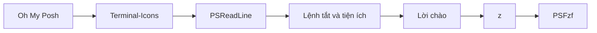

<div align="center">

# ⚡ Terminal Config

**Cấu hình PowerShell 7 cho Windows: prompt đẹp, gợi ý thông minh, gõ ít hơn.**

Oh My Posh · Terminal-Icons · PSReadLine · fzf · z · Git shortcuts · tiện ích tự viết

[](https://github.com/PowerShell/PowerShell)
[](https://www.microsoft.com/windows)
[](https://ohmyposh.dev/)

[](https://github.com/lieuquichuong2005/Terminal_Config/commits/main)
[](https://github.com/lieuquichuong2005/Terminal_Config)
[](https://github.com/lieuquichuong2005/Terminal_Config/stargazers)

[Cài đặt](#-cài-đặt) · [Hướng dẫn sử dụng](#-hướng-dẫn-sử-dụng) · [Bảng tra nhanh](#-bảng-tra-nhanh) · [Tuỳ chỉnh](#-tuỳ-chỉnh) · [Xử lý sự cố](#-xử-lý-sự-cố)

</div>

---

## 📑 Mục lục

- [✨ Tính năng](#-tính-năng)
- [📦 Yêu cầu](#-yêu-cầu)
- [🚀 Cài đặt](#-cài-đặt)
- [📖 Hướng dẫn sử dụng](#-hướng-dẫn-sử-dụng)
  - [🎨 Prompt Oh My Posh](#-prompt-oh-my-posh)
  - [🌈 Icon cho file và thư mục](#-icon-cho-file-và-thư-mục)
  - [💡 Gợi ý lệnh từ lịch sử](#-gợi-ý-lệnh-từ-lịch-sử)
  - [🌿 Lệnh tắt Git](#-lệnh-tắt-git)
  - [📂 Điều hướng và quản lý file](#-điều-hướng-và-quản-lý-file)
  - [🧭 Nhảy thư mục với z](#-nhảy-thư-mục-với-z)
  - [🔍 Tìm kiếm mờ với fzf](#-tìm-kiếm-mờ-với-fzf)
  - [🌐 Tạo dự án web](#-tạo-dự-án-web)
  - [📱 Mirror Android với scrcpy](#-mirror-android-với-scrcpy)
- [📋 Bảng tra nhanh](#-bảng-tra-nhanh)
- [🔧 Tuỳ chỉnh](#-tuỳ-chỉnh)
- [🔄 Cập nhật](#-cập-nhật)
- [🩺 Xử lý sự cố](#-xử-lý-sự-cố)
- [🧹 Gỡ cài đặt](#-gỡ-cài-đặt)
- [📁 Cấu trúc thư mục](#-cấu-trúc-thư-mục)
- [🙏 Ghi công](#-ghi-công)

---

## ✨ Tính năng

| | Tính năng | Mô tả ngắn |
|:-:|---|---|
| 🎨 | **Prompt Oh My Posh** | Theme `atomic`, hiển thị thư mục, nhánh Git, trạng thái, thời gian |
| 🌈 | **Terminal-Icons** | Icon và màu theo loại file khi `ls` |
| 💡 | **Gợi ý lệnh** | PSReadLine gợi ý từ lịch sử, hiển thị dạng danh sách |
| 🌿 | **Lệnh tắt Git** | `gs`, `gco`, `gl`, `gb`, `gf` |
| 📂 | **Điều hướng nhanh** | `..`, `...`, `lsf`, `ltree`, `mkf`, `cl` |
| 🧭 | **z** | Nhảy tới thư mục hay dùng chỉ bằng một từ khoá |
| 🔍 | **fzf** | `Ctrl+t` chọn file, `Ctrl+r` tìm lịch sử, `Alt+c` đổi thư mục |
| 🌐 | **NewWebProject** | Tạo khung dự án HTML/CSS/JS trong một lệnh |
| 📱 | **scrcpy** | Mở mirror màn hình Android |
| 👋 | **Lời chào** | Chào bạn mỗi lần mở terminal |

---

## 📦 Yêu cầu

| Công cụ | Bắt buộc | Dùng cho | Lệnh cài |
|---|:-:|---|---|
| [PowerShell 7+](https://github.com/PowerShell/PowerShell) | ✅ | Chạy profile | `winget install Microsoft.PowerShell` |
| [Git](https://git-scm.com/) | ✅ | Clone repo, lệnh tắt Git | `winget install Git.Git` |
| [Oh My Posh](https://ohmyposh.dev/) | ✅ | Prompt | `winget install JanDeDobbeleer.OhMyPosh` |
| [fzf](https://github.com/junegunn/fzf) | ✅ | `Ctrl+t`, `Ctrl+r`, `Alt+c` | `winget install junegunn.fzf` |
| [Nerd Font](https://www.nerdfonts.com/) | ✅ | Hiện icon trong prompt và `ls` | `oh-my-posh font install FiraCode` |
| [lsd](https://github.com/lsd-rs/lsd) | ⬜ | Lệnh `ltree` | `winget install lsd-rs.lsd` |
| [ripgrep](https://github.com/BurntSushi/ripgrep) | ⬜ | `Invoke-PsFzfRipgrep` | `winget install BurntSushi.ripgrep.MSVC` |
| [scrcpy](https://github.com/Genymobile/scrcpy) | ⬜ | Lệnh `scrcpy` | `winget install Genymobile.scrcpy` |

> [!NOTE]
> Ba module **PSFzf**, **Terminal-Icons** và **z** đã nằm sẵn trong thư mục `Modules/` của repo, không cần `Install-Module`.

---

## 🚀 Cài đặt

### Bước 1 — Cài các công cụ

Mở **Windows Terminal** và chạy:

```powershell
winget install Microsoft.PowerShell Git.Git JanDeDobbeleer.OhMyPosh junegunn.fzf lsd-rs.lsd
```

Tuỳ chọn thêm:

```powershell
winget install BurntSushi.ripgrep.MSVC Genymobile.scrcpy
```

### Bước 2 — Cài Nerd Font và đặt làm font của terminal

```powershell
oh-my-posh font install FiraCode
```

Sau đó đặt font cho terminal:

- **Windows Terminal**: `Settings` → `Profiles` → `Defaults` → `Appearance` → `Font face` → chọn **FiraCode Nerd Font**.
- **VS Code**: thêm vào `settings.json`:

  ```json
  "terminal.integrated.fontFamily": "FiraCode Nerd Font"
  ```

### Bước 3 — Clone repo vào thư mục profile

Mở một cửa sổ **`pwsh -NoProfile`** (để các module cũ không bị khoá file), rồi chạy:

```powershell
$dir = Split-Path $PROFILE                      # Thường là ~\Documents\PowerShell
if (Test-Path $dir) { Move-Item $dir "$dir.bak" } # Sao lưu cấu hình cũ nếu có
git clone https://github.com/lieuquichuong2005/Terminal_Config.git $dir
```

> [!TIP]
> Dùng `Split-Path $PROFILE` thay vì gõ cứng `~\Documents\PowerShell`, vì nếu thư mục Documents được OneDrive đồng bộ thì đường dẫn thật sẽ nằm trong `~\OneDrive\Documents\PowerShell`.

### Bước 4 — Mở lại terminal và kiểm tra

Đóng rồi mở lại Windows Terminal. Nếu thấy lời chào và prompt có màu là đã xong:

```text
========================================
👋 Welcome, <tên-bạn>! Happy coding.
========================================
```

Thử nhanh vài lệnh: `gs`, `lsf`, `ltree 1`, rồi bấm `Ctrl+r`.

---

## 📖 Hướng dẫn sử dụng

### 🎨 Prompt Oh My Posh

Prompt dùng theme [`atomic`](https://ohmyposh.dev/docs/themes#atomic), tự hiển thị:

- Shell đang dùng và thư mục hiện tại
- Nhánh Git và trạng thái repo khi đứng trong thư mục Git
- Giờ hiện tại ở góc phải

Không cần thao tác gì, prompt tự cập nhật sau mỗi lệnh. Muốn đổi theme, xem [Tuỳ chỉnh](#-tuỳ-chỉnh).

### 🌈 Icon cho file và thư mục

Mọi lệnh liệt kê (`ls`, `dir`, `Get-ChildItem`, `lsf`) đều có icon và màu theo loại file:

```powershell
ls
lsf ~\Downloads
```

Đổi sang bộ màu sáng nếu dùng nền trắng:

```powershell
Set-TerminalIconsTheme -ColorTheme devblackops_light
Show-TerminalIconsTheme   # Xem trước toàn bộ icon và màu
```

### 💡 Gợi ý lệnh từ lịch sử

Khi bạn gõ, PSReadLine hiện danh sách các lệnh từng chạy khớp với những gì đang gõ.

| Phím | Tác dụng |
|---|---|
| `↑` / `↓` | Chọn gợi ý trong danh sách |
| `→` | Nhận gợi ý đang hiển thị (ở chế độ một dòng) |
| `F2` | Chuyển qua lại giữa dạng danh sách và dạng một dòng |
| `Esc` | Bỏ gợi ý |

### 🌿 Lệnh tắt Git

| Lệnh | Tương đương | Ví dụ |
|---|---|---|
| `gs`  | `git status` | `gs -s` |
| `gco` | `git checkout` | `gco -b feature/login` |
| `gl`  | `git log --oneline --graph --all` | `gl -15` |
| `gb`  | `git branch` | `gb -d old-branch` |
| `gf`  | `git fetch origin` | `gf --prune` |

Mọi tham số thêm phía sau đều được chuyển thẳng cho `git`.

### 📂 Điều hướng và quản lý file

| Lệnh | Tác dụng | Ví dụ |
|---|---|---|
| `..` | Lên thư mục cha | `..` |
| `...` | Lên 2 cấp | `...` |
| `lsf [đường-dẫn]` | Liệt kê cả file ẩn | `lsf`, `lsf C:\Windows` |
| `ltree [độ-sâu]` | Cây thư mục kèm icon (cần `lsd`), mặc định sâu 3 cấp | `ltree`, `ltree 1` |
| `mkf <tên-file>` | Tạo file, tạo luôn thư mục cha nếu thiếu | `mkf src/app/main.js` |
| `cl` | Xoá màn hình | `cl` |

> [!NOTE]
> `mkf` an toàn với file đã có: nội dung được giữ nguyên, chỉ cập nhật thời gian sửa (giống lệnh `touch` trên Linux).

### 🧭 Nhảy thư mục với z

z ghi nhớ các thư mục bạn đã vào bằng `cd`, `pushd` hoặc `z`, rồi cho phép nhảy lại chỉ bằng một phần tên.

```powershell
cd D:\Projects\restaurant-game   # Vào thư mục một lần để z ghi nhớ
cd ~
z rest                           # Nhảy thẳng về D:\Projects\restaurant-game
```

| Lệnh | Tác dụng |
|---|---|
| `z <từ-khoá>` | Tới thư mục khớp từ khoá, ưu tiên thư mục vừa hay dùng vừa mới dùng |
| `z <từ-khoá> -o r` | Ưu tiên thư mục dùng nhiều nhất |
| `z <từ-khoá> -o t` | Ưu tiên thư mục dùng gần nhất |
| `z -l [từ-khoá]` | Liệt kê các thư mục đã ghi nhớ |
| `z -x` | Xoá thư mục hiện tại khỏi danh sách |
| `z -clean` | Xoá các thư mục không còn tồn tại |
| `z <từ-khoá><Tab>` | Gợi ý các thư mục khớp |

Dữ liệu được lưu ở `~\.cdHistory`.

### 🔍 Tìm kiếm mờ với fzf

| Phím | Tác dụng | Cách dùng |
|---|---|---|
| `Ctrl+t` | Chọn file/thư mục, chèn đường dẫn vào dòng lệnh | Gõ `code ` rồi `Ctrl+t`, chọn file, `Enter` |
| `Ctrl+r` | Tìm trong lịch sử lệnh | `Ctrl+r`, gõ vài chữ, `Enter` để đưa lệnh lên dòng nhập |
| `Alt+c` | Chọn thư mục con và `cd` vào đó | `Alt+c`, gõ tên, `Enter` |

Trong cửa sổ fzf:

| Phím / cú pháp | Tác dụng |
|---|---|
| Gõ bất kỳ | Lọc mờ, không cần gõ đúng thứ tự liền nhau |
| `↑` `↓` hoặc `Ctrl+k` `Ctrl+j` | Di chuyển |
| `Tab` | Đánh dấu nhiều mục (với `Ctrl+t`) |
| `Enter` / `Esc` | Chọn / huỷ |
| `'abc` | Khớp chính xác `abc` |
| `^abc` / `abc$` | Bắt đầu / kết thúc bằng `abc` |
| `!abc` | Loại trừ mục chứa `abc` |

<details>
<summary><b>Các lệnh fzf gọi trực tiếp</b></summary>

| Lệnh | Tác dụng |
|---|---|
| `Invoke-Fzf` | Lọc dữ liệu từ pipeline, ví dụ `Get-Process \| Invoke-Fzf` |
| `Invoke-FuzzyEdit` | Chọn file rồi mở bằng editor (`$env:VISUAL` hoặc `$env:EDITOR`, mặc định là `code`) |
| `Invoke-FuzzyHistory` | Chọn và chạy lại một lệnh cũ |
| `Invoke-FuzzySetLocation` | Chọn thư mục con rồi `cd` vào |
| `Invoke-FuzzyZLocation` | Chọn thư mục từ danh sách của z |
| `Invoke-FuzzyKillProcess` | Chọn tiến trình để tắt |
| `Invoke-FuzzyGitStatus` | Chọn file từ `git status` |
| `Invoke-PsFzfGitBranches` | Duyệt nhánh Git |
| `Invoke-PsFzfGitHashes` | Duyệt commit |
| `Invoke-PsFzfGitFiles` | Duyệt file trong repo |
| `Invoke-PsFzfGitStashes` | Duyệt stash |
| `Invoke-PsFzfGitTags` | Duyệt tag |
| `Invoke-PsFzfRipgrep <từ-khoá>` | Tìm nội dung file bằng ripgrep, lọc bằng fzf rồi mở kết quả trong editor |

</details>

### 🌐 Tạo dự án web

```powershell
NewWebProject portfolio
```

Lệnh tạo thư mục `portfolio`, sinh sẵn file mẫu rồi tự `cd` vào. Bước tiếp theo thường là:

```powershell
git init
code .
```

<details>
<summary><b>Cấu trúc được tạo ra</b></summary>

```text
portfolio/
├── index.html          # Khung HTML, đã link style.css và main.js
├── about.html
├── contact.html
├── package.json        # name + version 1.0.0
├── README.md
├── .gitignore
├── LICENSE
├── assets/
│   ├── css/            # style.css (reset + style mặc định), components.css
│   ├── js/             # main.js (log khi DOM sẵn sàng), utils.js
│   ├── img/
│   ├── fonts/
│   └── icons/
├── vendor/
│   ├── bootstrap/
│   └── aos/
├── docs/
├── dist/
└── tests/
    └── main.test.js
```

</details>

> [!IMPORTANT]
> - Lệnh sẽ dừng nếu thư mục cùng tên đã tồn tại và có nội dung, để không ghi đè dự án cũ.
> - Tên trong `package.json` được đổi sang dạng npm hợp lệ: `My Web App` → `my-web-app`.

### 📱 Mirror Android với scrcpy

Bật **USB debugging** trên điện thoại, cắm cáp, rồi:

```powershell
scrcpy                          # Mở mirror
scrcpy --turn-screen-off        # Tắt màn hình điện thoại khi mirror
scrcpy --stay-awake             # Giữ điện thoại không ngủ
scrcpy --max-size 1024          # Giảm độ phân giải cho mượt
scrcpy --record demo.mp4        # Vừa mirror vừa quay video
```

Lệnh tìm `scrcpy` trong `PATH` trước, nếu không có thì dùng `D:\Scrcpy\scrcpy.exe`. Không tìm thấy ở đâu sẽ in ra lệnh cài.

---

## 📋 Bảng tra nhanh

<table>
<tr><th>Nhóm</th><th>Lệnh / Phím</th><th>Tác dụng</th></tr>
<tr><td rowspan="5">🌿 Git</td><td><code>gs</code></td><td>git status</td></tr>
<tr><td><code>gco</code></td><td>git checkout</td></tr>
<tr><td><code>gl</code></td><td>git log dạng đồ thị</td></tr>
<tr><td><code>gb</code></td><td>git branch</td></tr>
<tr><td><code>gf</code></td><td>git fetch origin</td></tr>
<tr><td rowspan="7">📂 File</td><td><code>..</code> / <code>...</code></td><td>Lên 1 / 2 cấp thư mục</td></tr>
<tr><td><code>lsf</code></td><td>Liệt kê cả file ẩn</td></tr>
<tr><td><code>ltree [n]</code></td><td>Cây thư mục</td></tr>
<tr><td><code>mkf &lt;file&gt;</code></td><td>Tạo file</td></tr>
<tr><td><code>cl</code></td><td>Xoá màn hình</td></tr>
<tr><td><code>z &lt;từ-khoá&gt;</code></td><td>Nhảy thư mục</td></tr>
<tr><td><code>Alt+c</code></td><td>Chọn thư mục bằng fzf</td></tr>
<tr><td rowspan="4">⌨ Phím tắt</td><td><code>Ctrl+t</code></td><td>Chèn đường dẫn file bằng fzf</td></tr>
<tr><td><code>Ctrl+r</code></td><td>Tìm lịch sử bằng fzf</td></tr>
<tr><td><code>↑</code> <code>↓</code></td><td>Chọn gợi ý lệnh</td></tr>
<tr><td><code>F2</code></td><td>Đổi kiểu hiển thị gợi ý</td></tr>
<tr><td rowspan="2">🧰 Tiện ích</td><td><code>NewWebProject &lt;tên&gt;</code></td><td>Tạo dự án web</td></tr>
<tr><td><code>scrcpy [tham-số]</code></td><td>Mirror Android</td></tr>
</table>

---

## 🔧 Tuỳ chỉnh

Mở profile để sửa:

```powershell
code $PROFILE      # hoặc: notepad $PROFILE
. $PROFILE         # Nạp lại sau khi sửa, không cần mở terminal mới
```

<details>
<summary><b>🎨 Đổi theme Oh My Posh</b></summary>

Xem các theme tại [ohmyposh.dev/docs/themes](https://ohmyposh.dev/docs/themes), rồi đổi tên theme ở dòng `oh-my-posh init`. Dùng file theme có sẵn trên máy sẽ mở terminal nhanh hơn so với tải từ GitHub:

```powershell
oh-my-posh init pwsh --config "$env:POSH_THEMES_PATH\catppuccin_mocha.omp.json" | Invoke-Expression
```

</details>

<details>
<summary><b>👋 Tắt lời chào</b></summary>

Xoá hoặc thêm `#` trước 3 dòng `Write-Host` trong phần `# ----- Welcome Message -----`.

</details>

<details>
<summary><b>🌿 Bật phím tắt Git của fzf</b></summary>

Thêm vào profile, sau dòng `Import-Module PSFzf` (cần Git for Windows):

```powershell
Set-PsFzfOption -GitKeyBindings
```

| Phím | Tác dụng |
|---|---|
| `Ctrl+g` `Ctrl+b` | Chọn nhánh |
| `Ctrl+g` `Ctrl+f` | Chọn file |
| `Ctrl+g` `Ctrl+h` | Chọn commit |
| `Ctrl+g` `Ctrl+s` | Chọn stash |
| `Ctrl+g` `Ctrl+t` | Chọn tag |

</details>

<details>
<summary><b>🔍 Bật alias ngắn và Tab completion của fzf</b></summary>

```powershell
Enable-PsFzfAliases   # fe, fh, fd, fz, fkill, fgs...
Set-PSReadLineKeyHandler -Key Tab -ScriptBlock { Invoke-FzfTabCompletion }
```

| Alias | Lệnh gốc |
|---|---|
| `fe` | `Invoke-FuzzyEdit` |
| `fh` | `Invoke-FuzzyHistory` |
| `fd` | `Invoke-FuzzySetLocation` |
| `fz` | `Invoke-FuzzyZLocation` |
| `fkill` | `Invoke-FuzzyKillProcess` |
| `fgs` | `Invoke-FuzzyGitStatus` |

</details>

<details>
<summary><b>📝 Chọn editor cho <code>Invoke-FuzzyEdit</code></b></summary>

```powershell
$env:EDITOR = "code"   # hoặc "nvim", "notepad"
```

</details>

<details>
<summary><b>➕ Thêm lệnh tắt của riêng bạn</b></summary>

Thêm function vào profile, ví dụ:

```powershell
function gp { git pull @args }
function proj { Set-Location D:\Projects }
```

> Tránh đặt trùng tên alias có sẵn của PowerShell (kiểm tra bằng `Get-Alias <tên>`). Alias luôn được ưu tiên hơn function.

</details>

---

## 🔄 Cập nhật

```powershell
git -C (Split-Path $PROFILE) pull     # Lấy cấu hình mới nhất
winget upgrade JanDeDobbeleer.OhMyPosh junegunn.fzf lsd-rs.lsd
```

Cập nhật module đi kèm lên bản mới (rồi xoá thư mục phiên bản cũ trong `Modules/`):

```powershell
Save-Module PSFzf, Terminal-Icons, z -Path (Join-Path (Split-Path $PROFILE) Modules)
```

---

## 🩺 Xử lý sự cố

<details>
<summary><b>Icon hiện thành ô vuông hoặc dấu hỏi</b></summary>

Terminal chưa dùng Nerd Font. Làm lại [Bước 2](#bước-2--cài-nerd-font-và-đặt-làm-font-của-terminal).

</details>

<details>
<summary><b><code>oh-my-posh</code> / <code>fzf</code> is not recognized</b></summary>

Công cụ chưa được cài hoặc terminal chưa nhận `PATH` mới. Cài theo [Bước 1](#bước-1--cài-các-công-cụ), sau đó **đóng hẳn** Windows Terminal rồi mở lại.

</details>

<details>
<summary><b><code>Failed to find fzf binary in PATH</code></b></summary>

PSFzf cần file `fzf.exe`. Chạy `winget install junegunn.fzf` rồi mở lại terminal.

</details>

<details>
<summary><b>Profile không chạy, báo <code>running scripts is disabled</code></b></summary>

Cho phép chạy script cục bộ cho tài khoản hiện tại:

```powershell
Set-ExecutionPolicy -Scope CurrentUser RemoteSigned
```

</details>

<details>
<summary><b>Mở terminal bị chậm</b></summary>

Đo thời gian nạp profile:

```powershell
Measure-Command { pwsh -NoLogo -Command exit }            # Có profile
Measure-Command { pwsh -NoLogo -NoProfile -Command exit } # Không có profile
```

Profile hiện tải theme Oh My Posh từ GitHub. Chuyển sang file theme trên máy (xem [Đổi theme Oh My Posh](#-tuỳ-chỉnh)) sẽ nhanh hơn và không phụ thuộc mạng.

</details>

<details>
<summary><b><code>z</code> không nhảy được tới thư mục mong muốn</b></summary>

z chỉ ghi nhớ thư mục vào bằng `cd`, `pushd` hoặc `z`. Các lệnh `..`, `...` và `Alt+c` không được ghi lại. Vào thư mục đó một lần bằng `cd`, sau đó `z` sẽ tìm thấy.

</details>

---

## 🧹 Gỡ cài đặt

Chạy trong cửa sổ **`pwsh -NoProfile`** để các module không bị khoá file:

```powershell
$dir = Split-Path $PROFILE
Remove-Item $dir -Recurse -Force
if (Test-Path "$dir.bak") { Move-Item "$dir.bak" $dir }   # Khôi phục cấu hình cũ
```

---

## 📁 Cấu trúc thư mục

```text
PowerShell/
├── Microsoft.PowerShell_profile.ps1   # Profile chính, chạy mỗi khi mở pwsh
├── README.md
└── Modules/
    ├── PSFzf/2.6.10/                   # Tích hợp fzf vào PowerShell
    ├── Terminal-Icons/0.11.0/          # Icon theo loại file
    └── z/1.1.14/                       # Nhảy thư mục nhanh
```

Thứ tự profile nạp khi mở terminal:



---

## 🙏 Ghi công

| Dự án | Tác giả | Giấy phép |
|---|---|---|
| [Oh My Posh](https://github.com/JanDeDobbeleer/oh-my-posh) | Jan De Dobbeleer | MIT |
| [PSFzf](https://github.com/kelleyma49/PSFzf) | Michael Kelley | MIT |
| [Terminal-Icons](https://github.com/devblackops/Terminal-Icons) | Brandon Olin | MIT |
| [z](https://github.com/badmotorfinger/z) | Vince Panuccio | Unlicense |
| [fzf](https://github.com/junegunn/fzf) | Junegunn Choi | MIT |
| [lsd](https://github.com/lsd-rs/lsd) | lsd-rs | Apache-2.0 |
| [scrcpy](https://github.com/Genymobile/scrcpy) | Genymobile | Apache-2.0 |

---

<div align="center">

Made with ❤️ by [**@lieuquichuong2005**](https://github.com/lieuquichuong2005)

Nếu thấy hữu ích, hãy cho repo một ⭐ trên [GitHub](https://github.com/lieuquichuong2005/Terminal_Config)!

</div>
